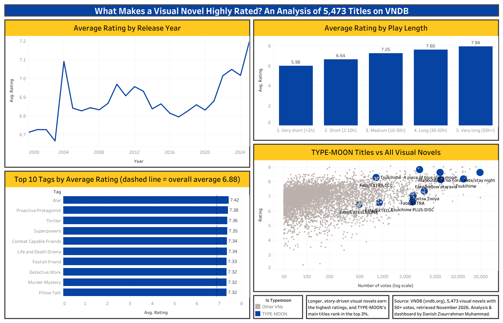

# What Makes a Visual Novel Highly Rated? An Analysis of VNDB Data

Analysis of 5,473 visual novels from [VNDB](https://vndb.org) using **SQL, Python, and Tableau** to find what is linked to higher user ratings, and how TYPE-MOON titles compare with the rest of the market.

**[View the interactive Tableau dashboard](https://public.tableau.com/app/profile/danish.ziaurrahman.muhammad/viz/WhatMakesaVisualNovelHighlyRated/VNDBDashboard)**

## Questions

1. How have visual novel releases and ratings changed over the years?
2. Do longer visual novels get higher ratings?
3. Which content tags (genres/themes) are linked to higher ratings?
4. How do TYPE-MOON titles (Fate/stay night, Tsukihime, Mahoyo) compare with the rest of the market?

## Data

- **Source:** VNDB (The Visual Novel Database) public API v2 (Kana), free for non-commercial use and subject to the [VNDB Data License](https://vndb.org/d17)
- **Scope:** 5,473 visual novels with at least 50 user votes, retrieved November 2026
- **Tables:** visual novels, content tags, developers, and platforms, loaded into a SQLite database for analysis

## Key findings

**Overall average rating: 6.88** (1–10 scale).

1. **Length is the strongest signal.** Average rating rises steadily from **5.98** for very short titles (<2h) to **7.94** for very long ones (50h+). The Spearman correlation between play length and rating is **0.68**.
2. **High-stakes stories score highest.** Tags such as War (7.42), Thriller (7.36), and Life and Death Drama (7.34) sit about 0.5 points above average, while lighter themes such as Parody (6.39) and Domicile (6.37) sit below it.
3. **Recent years look higher-rated, but partly due to a recency effect.** Titles reaching 50+ votes peaked in 2016 (382) and fell to 111 in 2025, while average ratings rose from 6.83 (2020) to 7.20 (2025). Newer titles have had less time to collect votes, so the ones already included tend to be the most popular.
4. **TYPE-MOON's main titles are top performers.** 6 of 11 TYPE-MOON titles rank in the top 3% of all visual novels, led by Tsukihime -A piece of blue glass moon- (8.81), Fate/stay night (8.63, the most-voted title with 19,548 votes), and Mahoutsukai no Yoru (8.62). Fan discs and action spin-offs rank below the median.

**Business takeaway:** among core visual novel fans, long, story-heavy titles with high-stakes conflict earn the best reception, which matches the profile of TYPE-MOON's top-rated works.

## Method

1. **Data collection (Python):** fetched data page by page from the VNDB API with rate-limit handling and retries.
2. **Cleaning (pandas):** flattened nested JSON into tables, converted release dates to years, and rescaled ratings from 10–100 to 1–10.
3. **Analysis (SQL):** loaded tables into SQLite and answered each question with SQL queries, including CASE grouping, joins, HAVING filters, and a PERCENT_RANK window function.
4. **Visualization (Matplotlib & Tableau):** exploratory charts in the notebook, then an interactive dashboard in Tableau Public.

## Limitations

- VNDB is crowdsourced, and its users are mostly English-speaking enthusiasts, so ratings reflect that community.
- Only titles with 50+ votes are included, which favours better-known titles and makes recent years look smaller and higher-rated.
- Findings show correlation, not causation: longer or war-themed games are not automatically better.
- Titles with adult-only releases are included because VNDB groups all-ages and adult releases under one entry; the analysis uses only aggregate ratings, not images or descriptions.

## Tools

Python (requests, pandas, NumPy, Matplotlib), SQL (SQLite), Tableau Public, Google Colab

## Files

| File | Contents |
|---|---|
| `vndb_analysis.ipynb` | Full notebook: data collection, cleaning, SQL analysis, charts |
| `dashboard.png` | Screenshot of the Tableau dashboard |

---
*Created by Danish Ziaurrahman Muhammad · Data from [VNDB](https://vndb.org)*
